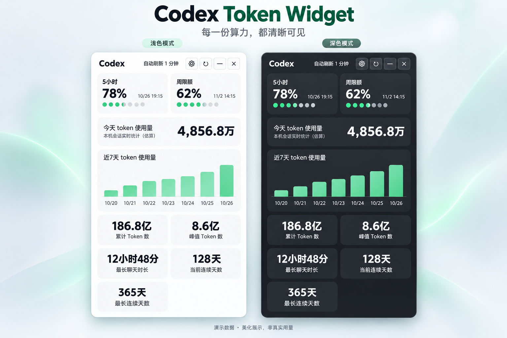

# Codex Token Widget

[简体中文](README.md) | [English](README.en.md)

Windows 桌面悬浮组件：显示 Codex 的 5 小时和周限额、今天的 token 使用量，以及近 7 天柱状图。

使用 C# / WPF / .NET 8 开发，支持打包为独立的 Windows x64 单文件 EXE。本项目由社区维护，与 OpenAI 无隶属关系。

A lightweight Windows desktop widget for Codex usage: track 5-hour and weekly limits, today's tokens, and a 7-day usage chart. Built with C# / WPF / .NET 8, with Chinese, English, and automatic system language selection. Available as a standalone Windows x64 executable. Community-maintained; not affiliated with OpenAI.

## 界面预览

### 浅色与深色主题

限额、今日用量与历史统计，一眼掌握。



### 自定义设置与边缘进度条

按习惯调整刷新频率、主题和显示卡片；贴边收起后，通过轻巧的进度条查看用量。


> 以上图片基于实际界面截图，经 AI 重新制作与美化。用量、时长和连续天数均为演示数据，不代表作者真实使用记录；字体、间距和部分控件外观经过展示优化，实际以程序为准。

## 功能

- 5 小时与周限额、重置时间。
- 今日 Token 使用量与近 7 天柱状图。
- 累计 Token、单日峰值、最长聊天时长和连续使用天数（取决于数据源支持）。
- 桌面悬浮、拖动、边缘吸附收起和托盘菜单。
- 自动刷新、浅色 / 深色 / 系统主题，以及按需显示统计卡片。
- 中文 / English / 跟随系统语言，保存后立即切换；数字与时长单位同步本地化。

## 语言设置

点击组件的设置按钮，在“语言 → 界面语言”中选择：

| 选项 | 行为 |
| --- | --- |
| 跟随系统（默认） | 跟随 Windows 用户界面语言：英文系统使用 English，中文及其他系统回退简体中文。 |
| 中文 | 始终使用简体中文。 |
| English | 始终使用英文。 |

点击“保存”立即生效，无需重启。选择会保存在本机设置文件中；旧版本配置没有语言字段时自动采用“跟随系统”。语言和浅色 / 深色主题各自独立，主题也可以跟随系统。

中文数字采用“万 / 亿”，英文采用“K / M / B”；语言设置只改变显示格式，不改变统计数据。

## 运行要求

- Windows 10 / 11，x64。
- 已安装并登录 Codex；程序优先从 `%LOCALAPPDATA%\OpenAI\Codex\bin` 查找 `codex.exe`，否则使用 PATH 中的 `codex`。
- Codex app-server 需要支持 `account/rateLimits/read` 与 `account/usage/read`。不同版本的协议支持可能不同。

从 [Releases](https://github.com/GMMG55/codex-token-widget/releases) 下载 EXE，放到固定目录后双击运行；独立发布版本无需额外安装 .NET。组件可拖动，刷新按钮会重新读取数据，设置按钮可调整显示和刷新频率。

## 数据来源与本地文件

限额和历史数据来自本机执行的 `codex app-server --stdio`。今日用量优先读取 `%USERPROFILE%\.codex\sessions` 中的 `token_usage_record`，按本地日期汇总，并按响应 ID 去重；该值属于本机估算，可能与后台统计存在差异。后台统计可能延迟。

app-server 查询失败时，程序可能保留上一次限额缓存，或仅显示本机今日用量；尚未同步的数据会显示为等待状态。

组件不抓取网页或浏览器数据，也没有自行上传统计数据的代码；app-server 使用已有 Codex 登录状态，可能访问其后端服务。设置与错误日志存放在 `%LOCALAPPDATA%\CodexTokenWidget`。提交问题时请先检查日志并移除个人信息。

设置中有启动相关选项；当前启动流程会尝试写入当前用户的 Windows 开机启动项，并创建桌面快捷方式。可在 Windows“设置 → 应用 → 启动”管理启动项。“跟随 Codex 启动”会在未检测到 Codex 进程时暂时隐藏窗口，并定期检测后显示；进程名匹配较宽，实际效果取决于本机进程环境。

## 从源码构建

在 Windows 上安装 .NET 8 SDK 后执行：

```powershell
git clone https://github.com/GMMG55/codex-token-widget.git
cd codex-token-widget
dotnet build -c Release
```

运行语言与界面检查：

```powershell
dotnet run --project tests/LocalizationChecks -c Release
```

## 发布单文件 EXE

```powershell
dotnet publish -c Release -r win-x64 --self-contained true -p:PublishSingleFile=true -o .\publish
```

生成文件：`publish\CodexTokenWidget.exe`。构建目录、协议生成文件和本地数据均不纳入源码仓库。

## 贡献与许可证

欢迎提交 Issue 或 Pull Request。问题报告请附 Windows 版本、Codex 版本和复现步骤，请勿上传登录凭据或完整会话记录。

本项目采用 [MIT 许可证](LICENSE)。
